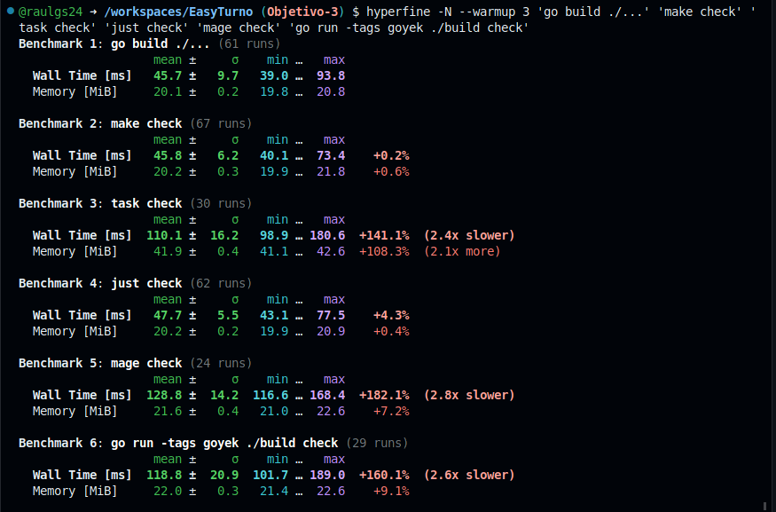
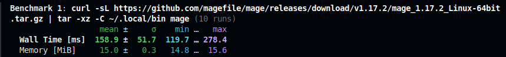
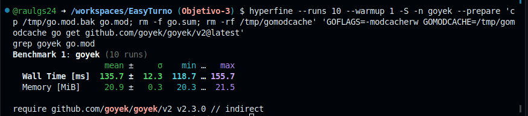

# Elección de gestor de dependencias y gestor de tareas

## Gestor de dependencias

EN Go las opciones son Go Modules, [dep](https://github.com/golang/dep), [Glide](https://github.com/Masterminds/glide), [godep](https://github.com/tools/godep), [govendor](https://github.com/kardianos/govendor), [gb](https://github.com/constabulary/gb) y el modo GOPATH; dep, godep, govendor y gb están archivados, Glide avisa en su README que está prácticamente sin mantenimiento, y el modo GOPATH dejó de ser el modo por defecto en Go 1.16. Queda Go Modules, que viene con la propia orden go y se declara en go.mod

## Gestor de tareas

- Tiempo de instalación desde que empieza la instalación hasta que la orden se puede ejecutar, usando el método más rápido que ofrezca cada herramienta e instalandola en mi espacio de usuario. Es necesario medirlo porque la herramienta se instalará en cada construcción del contenedor (Objetivo 5) y en cada ejecución de la CI (Objetivo 6).
- Tiempo que añade el gestor al ejecutar check, la diferencia entre la media de `<gestor> check` y la de go build ./... lanzado directamente. Lo mido porque check se lanzará en cada cambio.

### Opciones
Las medidas están hechas en un Github Codespace. Para check, todos los gestores se miden en una misma ejecución de hyperfine junto a go build ./... que sirve de referencia (45.7ms)

Como opciones tenemos: make, Task, just, Mage y goyek

- **[make](https://www.gnu.org/software/make/)** (`Makefile`): descargo su paquete de ubuntu y extraigo el binario a mi espacio de usuario con una media de 0.23s, make check tarda de media 45.8ms. No añade tiempo razonable 

  

- **[Task](https://github.com/go-task/task)** (`Taskfile.yml`): con una única orden descargo el binario de su release a mi espacio de usuario en 0.56s de media, task check tarda 110.1 ms de media. Por lo que añade un tiempo considerable
Se puede descargar también con go install, pero tarda mucho más. 

  

-  **[just](https://github.com/casey/just)** (`justfile`): con una única orden descargo el binario de su release a mi espacio de usuario en 0.16s. just check tarda 47.7ms. No añade tiempo apreciable

  

- **[Mage](https://github.com/magefile/mage)** (`magefile.go`): descargar el binario de sus releases a mi espacio tarda de media 0.15s. mage check tarda 128ms de media. Añade un tiempo considerable.
También se puede instalar con go install pero tardaría mucho más

  

- **[goyek](https://github.com/goyek/goyek)** (biblioteca de Go): no se instala como programa, se añade con `go get`: que con la caché de módulos vacía tarda de media 0.14s, go run ./build check tarda 118.8ms, mucho más que con go build ./...
  
  

### Decisión
make y just son los únicos que no añaden un tiempo apreciable a check; Task, Mage y goyek añaden tiempo extra en cada ejecución. Entre make y just, just se instala de media en 0.16s frente a 0.23s de make. Como la instalación se repetirá en cada construcción del contenedor y en cada ejecución de la CI, por lo que elijo just.