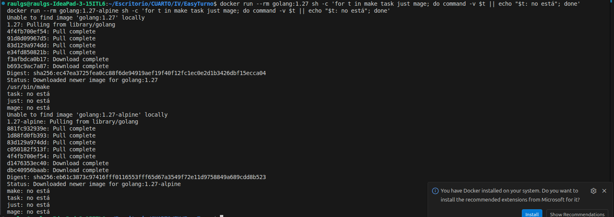

# Elección de gestor de dependencias y gestor de tareas

## Gestor de dependencias

EasyTurno solo importa `time`, de la biblioteca estándar, así que no tiene dependencias externas. Aun así, necesito:

- **Que `internal/easyturno` compile**, porque `check` depende de ello.
- **Que compile igual en mi máquina, en el contenedor (objetivo 5) y en la CI (objetivo 6).**
- **No añadir peso ni tiempo de instalación a la imagen.**
- **Que cuando llegue la primera dependencia (por ejemplo, en los tests) se instale siempre la misma versión.**

Las alternativas a tener en cuenta son Go Modules, dep, Glide y el modo GOPATH.

Descartadas:

- **dep y Glide:** archivados.
- **Modo GOPATH:** sigue en la herramienta, pero no fija versiones.

Por tanto, la decisión es Go Modules: es el estándar del lenguaje, el modo por defecto desde Go 1.16, y cubre las cuatro necesidades anteriores:

- **Compila:** `go.mod` declara el módulo; sin él, `go build` falla.
- **Igual en todas partes:** la línea `go` de `go.mod` fija la versión de Go.
- **Sin peso:** va dentro de la orden `go`, no instala nada.
- **Misma versión:** `go.mod` fija versiones y `go.sum` guarda sus sumas de verificación.

## Gestor de tareas

Go Modules no sirve como gestor de tareas, ya que la orden go no tiene un fichero donde definir tareas propias. Necesito:
- **Una orden única para cada tarea:** ahora `install` y `check`
- **Que check compruebe solo la sintaxis**, es decir, que compile
- **Que se instale rápido,** ya que se instalará en cada construcción del contenedor (objetivo 5) y cada ejecución de la CI (objetivo 6)
- **Que no añada tiempo apreciable al ejecutar las tareas,** porque se lanzarán en cada cambio
- **Que no añada dependencias a go.mod.**

### Criterios:
* Tiempo de instalación.
* Tiempo de ejecución de `check` comparado con `go build`.
* Dependencias que añade a `go.mod`.

### Opciones
Como referencia, `go build` sin gestor tarda 0.048-0.109s:

Como opciones tenemos: make, Task, just, Mage y goyek
- **[make]** (`Makefile`): Ya está instalado en mi máquina; `make check` tarda entre 0.041 y 0.109s, lo mismo que sin gestor.

  
  

- **[Task]** (`Taskfile.yml`): se tuvo que instalar; `task check` tarda entre 0.127 y 0.261s, más que sin gestor

  

- **[just]** (`justfile`): se tuvo que instalar, `just check` tarda entre 0.035 y 0.077s, lo mismo que sin gestor

  

- **[Mage]** (`magefile.go`): se tuvo que instalar; la primera ejecución tarda 0.38s porque compila el magefile.go y las siguientes entre 0.083 y 0.087s

  

- **[goyek]** (biblioteca de Go): no se instala como programa, se añade con `go get`: la primera ejecución de `go run ./build check` tarda 0.39s, las siguientes entre 0.219 y 0.257s, unos 0.15-0.20s más que sin gestor; añade una dependecia a `go.mod` y crea `go.sum`

  
  

### Disponibilidad en cada entorno

He comprobado con command -v cuáles vienen ya en cada entorno, sin instalar nada:

| Entorno | make | Task | just | Mage |
|---|---|---|---|---|
| Mi máquina (Ubuntu) | Sí | No | No (lo instalé para las pruebas) | No |
| Imagen `golang:1.27` | Sí | No | No | No |
| Imagen `golang:1.27-alpine` | No | No | No | No |
| Runner de GitHub (Ubuntu 24.04 y 26.04) | Sí | No | No | No |

goyek no aparece en la tabla debido a que no es un programa, es una dependencia del go.mod

Por tanto, los criterios apuntan a **make**: es el único que viene ya en mi máquina, en la imagen golang:1.27 y en el runner de GitHub, no añade tiempo a check y no toca go.mod. just y mage obligarían a añadir un paso de instalación en el contenedor y en la CI, y goyek añade una dependencia a go.mod

El punto débil es la imagen golang:1.27-alpine, donde make tampoco viene instalado. Si en el objetivo 5 se elige una imagen basada en Alpine, habría que instalarlo.

