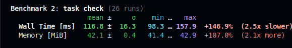
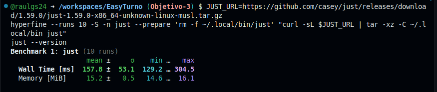

# Elección de gestor de dependencias y gestor de tareas

## Gestor de dependencias

EN Go las opciones son Go Modules, [dep](https://github.com/golang/dep), [Glide](https://github.com/Masterminds/glide), [godep](https://github.com/tools/godep), [govendor](https://github.com/kardianos/govendor), [gb](https://github.com/constabulary/gb) y el modo GOPATH; dep, godep, govendor y gb están archivados, Glide avisa en su README que está prácticamente sin mantenimiento, y el modo GOPATH dejó de ser el modo por defecto en Go 1.16. Queda Go Modules, que viene con la propia orden go y se declara en go.mod

## Gestor de tareas

- Tiempo de instalación desde que empieza la instalación hasta que la orden se puede ejecutar, usando el método más rápido que ofrezca cada herramienta e instalandola en mi espacio de usuario. Es necesario medirlo porque la herramienta se instalará en cada construcción del contenedor (Objetivo 5) y en cada ejecución de la CI (Objetivo 6)
- Tiempo que añade el gestor al ejecutar check, la diferencia entre la media de <gestor> check y la de go build ./... lanzado directamente. Lo mido porque check se lanzará en cada cambio

### Opciones
Las medidas están hechas en un Github Codespace. Para check, cada gestor se mide en la misma ejecución de hyperfine que go build ./..., que sirve de referencias

Como opciones tenemos: make, Task, just, Mage y goyek

- **[make](https://www.gnu.org/software/make/)** (`Makefile`): descargar y descomprimir el paquete en mi espacio tarda 1.51s de media,  make check tarda 49.7ms frente a 48.3 ms de go build ./... (no añade tiempo apreciable)

  
  

- **[Task](https://github.com/go-task/task)** (`Taskfile.yml`): su script oficial, que descarga el binario, lo instala en mi espacio en 1.13s de media, task check tarda unos 116.8 ms de media frente a los 48.3ms de go build ./... .No añade tiempo apreciable
Se puede descargar también con go install, pero tarda mucho más. 

  
  

-  **[just](https://github.com/casey/just)** (`justfile`): su script oficial que descarga el binario lo instala en mi espacio de usuario de media en 0.66s. just check tarda 52.5ms frente a los 48.3ms de go build ./...
No añade tiempo apreciable
  
  

- **[Mage](https://github.com/magefile/mage)** (`magefile.go`): se tuvo que instalar; la primera ejecución tarda 0.38s porque compila el magefile.go y las siguientes entre 0.083 y 0.087s

  ![Instalación de Mage]
  

- **[goyek](https://github.com/goyek/goyek)** (biblioteca de Go): no se instala como programa, se añade con `go get`: la primera ejecución de `go run ./build check` tarda 0.39s, las siguientes entre 0.219 y 0.257s, unos 0.15-0.20s más que sin gestor.
  ![Instalación de goyek]
  

